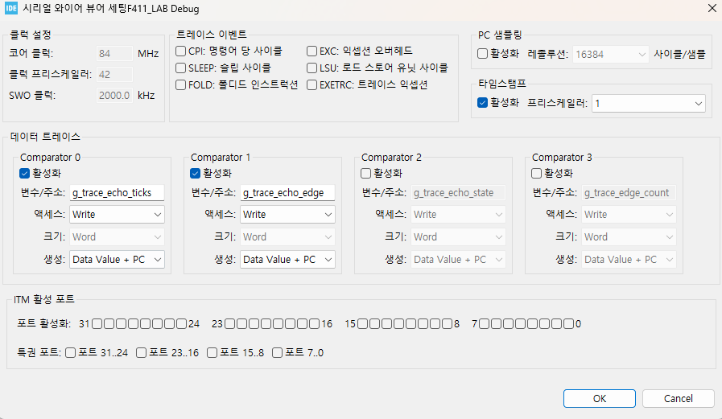
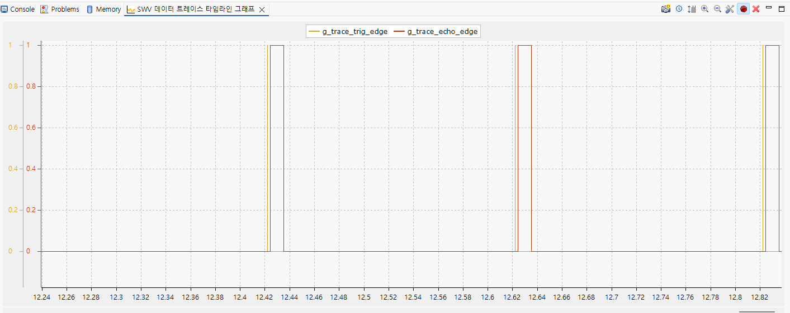
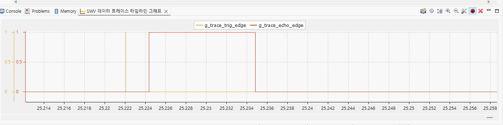
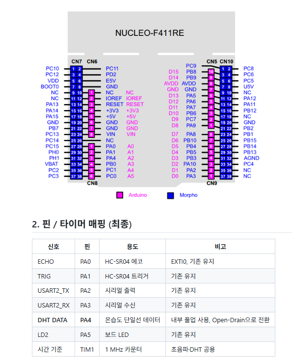
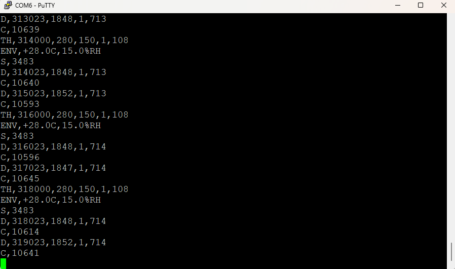
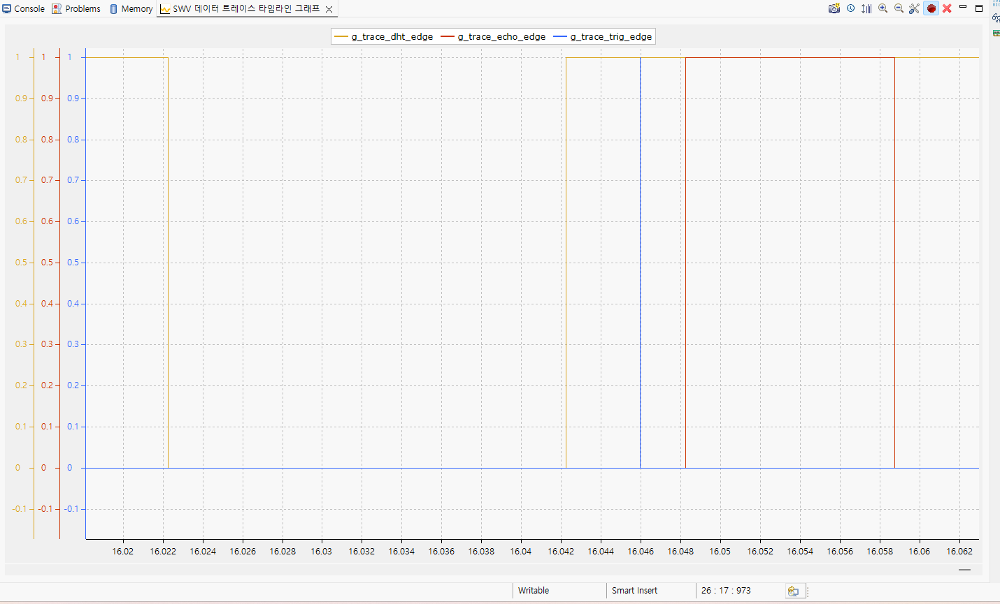

## ultrasonic putty
<details>

<summary> ultrasonic putty </summary>


 <br>

</details>

---

---
## ultrasonic oscilloscope 
<details>

<summary> ultrasonic oscilloscope </summary>


 <br>

- cursor를 시간으로 변경 후 오실로스코프에 나오는 거리의 절반이 실제 ultrasonic sensor와 물체의 거리
  
</details>

---


---
## SWV / 트레이스 관찰 
<details>

<summary> SWV / 트레이스 관찰 </summary>


 <br>
 <br>
 <br>

</details>

---

---
## SWV / trig trace 관찰 (Rising/Falling edge)  
<details>

<summary> SWV / trig trace 관찰 (Rising/Falling edge)   </summary>


 <br>

 <br>


</details>

---

---
## F411_LAB 초음파 + 온습도(DHT)
<details>

<summary> F411_LAB 초음파 + 온습도(DHT)   </summary>


 <br>

 <br>

 <br>


</details>

---


---
## F411_LAB 최종 작업 정리 — 초음파 + 온습도 + FreeRTOS 
<details>

<summary> F411_LAB 최종 작업 정리 — 초음파 + 온습도 + FreeRTOS </summary>


- 설정 1 
 <br>
---

- 설정 2
 <br>

```c
/* USER CODE BEGIN Header_StartUltrasonicTask */
/**
* @brief Function implementing the myTask02 thread.
* @param argument: Not used
* @retval None
*/
/* USER CODE END Header_StartUltrasonicTask */
void StartUltrasonicTask(void *argument)
{
  /* USER CODE BEGIN StartUltrasonicTask */
  Ultrasonic_Result result;
  char line[80];

  for(;;)
  {
    Ultrasonic_Task();

    if (Ultrasonic_GetResult(&result) != 0U)
    {
      (void)snprintf(line, sizeof(line), "D,%lu,%u,%u,%lu\n",
                     (unsigned long)result.timestamp_ms,
                     (unsigned int)result.distance_mm,
                     (unsigned int)result.valid,
                     (unsigned long)result.errors);

      (void)osMutexAcquire(myMutex01Handle, osWaitForever);
      printf("%s", line);
      printf("C,%u\n", (unsigned int)Ultrasonic_GetLastEchoTicks());
      (void)osMutexRelease(myMutex01Handle);
    }

    osDelay(10);
  }
  /* USER CODE END StartUltrasonicTask */
}
```

```c
/* USER CODE BEGIN Header_StartDhtTask */
/**
* @brief Function implementing the myTask03 thread.
* @param argument: Not used
* @retval None
*/
/* USER CODE END Header_StartDhtTask */
void StartDhtTask(void *argument)
{
  /* USER CODE BEGIN StartDhtTask */
  Dht_Result dht;
  char line[96];
  int32_t temperature;
  uint16_t speed_x10;

  for(;;)
  {
    Dht_Task();

    if (Dht_GetResult(&dht) != 0U)
    {
      temperature = (int32_t)dht.temperature_c_x10;
      (void)snprintf(line, sizeof(line), "TH,%lu,%d,%u,%u,%lu\n",
                     (unsigned long)dht.timestamp_ms,
                     (int)temperature,
                     (unsigned int)dht.humidity_rh_x10,
                     (unsigned int)dht.valid,
                     (unsigned long)dht.errors);

      (void)osMutexAcquire(myMutex01Handle, osWaitForever);
      printf("%s", line);
      printf("ENV,%c%u.%uC,%u.%u%%RH\n",
             (temperature < 0) ? '-' : '+',
             (unsigned int)((temperature < 0) ? -temperature : temperature) / 10U,
             (unsigned int)((temperature < 0) ? -temperature : temperature) % 10U,
             (unsigned int)dht.humidity_rh_x10 / 10U,
             (unsigned int)dht.humidity_rh_x10 % 10U);

      if (dht.valid != 0U)
      {
        speed_x10 = Sensor_SoundSpeedX10(dht.temperature_c_x10,
                                         dht.humidity_rh_x10);
        Ultrasonic_SetSoundSpeedX10(speed_x10);
        printf("S,%u\n", (unsigned int)speed_x10);
      }
      (void)osMutexRelease(myMutex01Handle);
    }

    osDelay(100);
  }
  /* USER CODE END StartDhtTask */
}
```

 <br>

- 가까운 거리
 <br>

---

-먼 거리
 <br>


  
</details>

---
